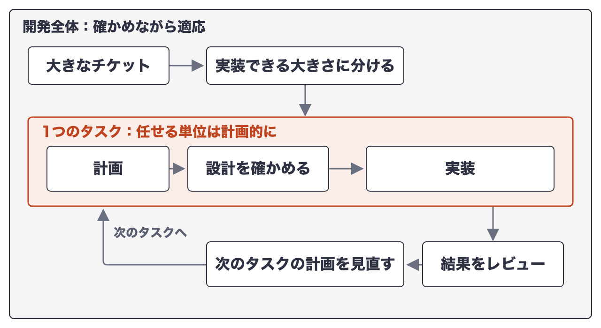
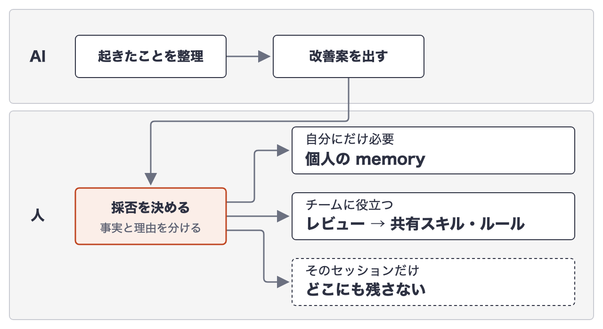
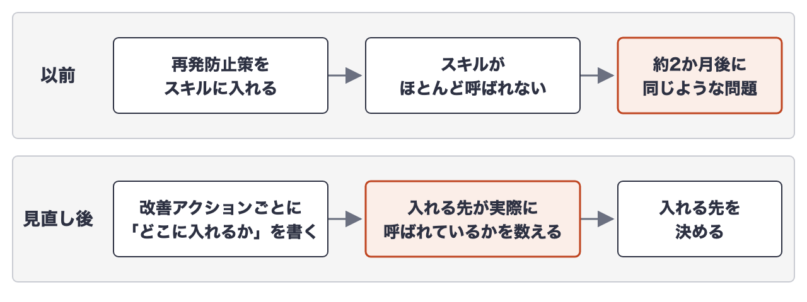

# AIに任せて、確かめて、一緒に振り返る。アジャイルで培った改善をAI駆動開発でも続ける

> 区分: 会社公式（PRONI）

PRONI株式会社のプロダクト開発部で、開発プロセスづくりに取り組んでいるみね（[@mine\_take](https://x.com/mine_take)）です。

AIエージェントと開発していると、要件を整理し、設計し、計画を確かめてから実装する進め方が合っていると感じることがあります。AIに任せるには、何を作り、何を確認するかを先に決めておいたほうが進めやすいからです。一つひとつのタスクは、小さな「プチウォーターフォール」に見えます。

それでも私たちは、これまでのプロダクト開発で続けてきたアジャイルの考え方を手放していません。大きな仕事を小さく分ける。動くものを確かめる。フィードバックを受けて、次の進め方を変える。AIと開発するようになっても、この考え方は変わらず大切だと思っています。

この記事で伝えたいことは、三つの文にまとまります。

**AIに仕事を任せる。その仕事を人が確かめる。そして、AIと一緒に仕事の進め方を振り返り、次の開発で試してみる。**

なかでも、最近あらためて大切だと感じているのが三つ目の振り返りです。その実践と、やってみて気づいたことを書きます。

これまでの記事では、[『AI駆動開発でSDDを考え直した。DiscoveryとDeliveryでは「先に定義するもの」が違った』](https://note.com/mine_unilabo/n/n062a695d5af9)と[『個人のAI開発ナレッジを、チームの改善ループへ育てるまで』](https://note.com/mine_unilabo/n/nf85851cf7f48)を書きました。

## タスクは計画的に、開発全体は確かめながら

AIに任せる単位では、計画を立て、設計を確かめてから実装へ進みます。この流れだけを見ると、ウォーターフォールに近い印象を持つかもしれません。

ただ、個々のタスクの進め方と、プロダクト開発全体の進め方は別だと考えています。大きなチケットをそのままAIに渡さず、実装できる大きさに分ける。タスクごとに計画を確かめ、結果をレビューする。分かったことがあれば、次のタスクの計画を見直す。

タスクの中では段階的でも、全体では小さなフィードバックのループを何度も回しています。**任せる単位は計画的に、開発全体は確かめながら適応します。** この二つは対立しません。

## 確かめるのは、コードだけではない

AIに任せた計画やコードは、人が確かめます。計画をレビューし、PR（Pull Request）をレビューし、テストの結果を見ます。私たちは、こうした確認をエージェントスキルやワークフローに組み込んできました。

ただ、コードを確かめることと、**コードができるまでの進め方を確かめること**は違います。

PRで指摘を受けてコードを直せば、目の前の問題は解決します。でも、次の開発で同じ指摘を受けないようになったかは別の話です。計画の段階で気づけなかったのか。タスクをもう少し小さく分けられたのか。スキルの確認項目が足りなかったのか。

こうした問いを扱うために、アジャイルで続けてきた振り返りを、AIとの開発にも持ち込んでいます。

## AIと一緒に振り返る

私たちの普段の開発はClaude Codeが中心です。振り返りもスキルにしていて、AIが作業中に起きたことを整理し、改善の候補を出します。

振り返りの型として私たちに馴染みがあったのはKPT（Keep / Problem / Try）です。ただ、この記事のために記録を見直すと、毎回KPTの形で残っていたわけではありませんでした。残っていたのは、起きたことの整理、AIの改善案、人の採否、スキルやルールへの反映という流れです。型がそろっていなくても、振り返って次の行動を決める部分は回っていました。

AIのまとめを読んで終わりにはしません。人が読むときには、いくつかの観点で吟味します。書かれているのは実際に起きたことか、原因の推測か。次も起こりそうか。スキルに足すべきか、今回限りでよいか。AIが整理できるのは参照できる記録の範囲で、原因の説明は仮説のこともあります。**起きた事実と、そこから考えた理由を分ける**のは、人と人の振り返りと同じです。

AIとの振り返りの単位は二つあります。

- 開発セッションの終わり：経緯が分かるうちに、その作業の手戻りや学びを拾う
- 週1回（直近30日）：複数のセッションをまたいで、繰り返している依頼や作業を探す

近くで見ると一つの失敗が見え、少し離れると繰り返しているパターンが見えます。セッション単位の振り返りは、ある社内プロダクトの開発で約1か月に40回近く実行していました。直近30日を見る振り返りは、毎週実施しています。

これとは別に、スプリントの終わりにはチームで振り返っています。AIの活用の仕方やナレッジの共有、チームとしての改善行動も、そこで話し合います。チームの振り返りの前には、AIとのコマンドを実行しています。このコマンドで直近90日分もまとめて見直し、AI活用に関する数値も計測しています。その数値の変化を、チームの振り返りで話すこともあります。

## 学びを、次の開発に持ち込む

AIと振り返る面白さは、「次は気をつけよう」で終わらせず、次のAIの作業方法そのものに組み込めることです。

ある振り返りで、AIはセルフレビューのスキルに追加したい観点を3件挙げました。人が1件に絞り、残り2件は取り下げました。残したのは「動作を変えないはずのリファクタリングで、元の実装にない条件を足していないか」を確かめる観点です。

PRで受けた指摘から始まった例もあります。PRを振り返るスキルにかけると、AIは見落とした原因を分析し、レビュー観点への追記案を出しました。人が採用を決め、チームで使うスキルへの変更としてPRにし、同僚のレビューを経てマージしました。一人のセッションで得た学びが、チームで使うスキルに移った例です。

ただし、AIの案をすべて入れるわけではありません。学びが誰に効くかで、残す先を決めています。

チームのスキルを変えるときは、新しく作るときも直すときもレビューを通します。みんなが使うものを、一人の振り返りで勝手に変えないためです。

## 入れた対策が、使われていなかった

振り返りの大切さを一番痛感したのは、うまくいかなかったときでした。

以前、振り返りで決めた再発防止策を、あるスキルに組み込みました。ところが約2か月後、同じような問題がもう一度起きました。調べると、対策を入れたスキルは、実際の作業ではほとんど呼ばれていませんでした。

対策は存在していました。でも、必要な場面で使われなければ、次の仕事のやり方は変わりません。

そこで、振り返りのスキル自体を振り返って直しました。改善アクションごとに「どこに入れるか」を書き、入れる先が実際に呼ばれているかを数えてから決める手順を足しました。

対策を入れた場所による違いも見えてきました。memory（AIが次の作業でも読み込む個人用のメモ）に書いただけの対策では、同じ種類の問題が再び起きた例がいくつもありました。hook（決まった操作の前後に自動で動く仕組み）や設定の変更として入れた対策は、その後の再発がまだ見つかっていません。数が少ないので、傾向として見ています。

**振り返りでTry（次に試す改善）を決めることと、Tryが次の仕事のやり方を変えることは違います。** アジャイルで振り返りを続けてきたつもりでも、AIのスキルに改善を残すようになって、確かめることが一つ増えました。改善を置いた場所が、実際に使われる場所なのかどうかです。

## 何でも仕組みにはしない

振り返りを続けると、AIはたくさんの改善案を出してくれます。毎回スキルやルールに足していたら、今度はそれらを理解して使い分けること自体が重荷になります。学びの残し先を示した図で「どこにも残さない」を選択肢として持っているのは、そのためです。入れないと決めたときも、その理由を残します。

だから、増やさない判断もしています。手順の文面は自動では検知できないため、チェックを足さず、手順に2行加えるだけにとどめた例があります。一度入れた承認のゲートを、スキルの役目ではないと考えて取り下げたこともあります。既知の問題を、認識するだけでチケットにしないと決めたこともあります。

**振り返りの出口は、必ずしも新しいルールを増やすことではありません。** 何を変えるかだけでなく、何を変えないか、何をやめるかも決めます。AIが提案できることが増えた今、その判断の重みは増していると感じています。

## いま取り組んでいる課題

振り返りを続けて、手戻りが減ったことは実感しています。対策が使われたか、同じ問題が起きたかを見られる例も出てきました。ただ、これはまだ開発の進め方という、アウトプットに近い側の変化です。AI活用の数値は見ていても、それが生産性やプロダクトの成長というアウトカム、さらに事業へのインパクトにどうつながっているかは、まだ十分に計測できていません。改善を出して終わりにせず、その先の成果まで確かめられるようにすることが、いま取り組んでいる課題の一つです。

もう一つは、人の関わり方です。今は、AIの改善案を人が確かめて採否を決める、人が工程の中に入る形（Human-in-the-Loop: HITL）をとっている部分があります。一方で、振り返りの最後に人が返事をしないまま、個人の memory に残すかをAIが決めていた回も多くありました。意図した形ではなく、確認が抜けていた回です。

この抜けを放置せず、人が意図して見守る形に変えていくことも、取り組んでいる課題です。チームのスキルのように影響の大きいものは引き続きレビューで判断しつつ、影響の小さいものからAIに任せる範囲を広げていく予定です。人が毎回判断するのではなく、流れを見守り、必要なときに介入する。そうした Human-on-the-Loop（HOTL）の形へ、少しずつ移していきたいと考えています。

## おわりに

AIエージェントを使えば、実装の進め方は大きく変わります。それでも、これまでの開発で培ってきた考え方を置き換える必要はないと思っています。人と人で行ってきた計画、レビュー、振り返りを、AIとの協働に合わせて設計し直す機会だと感じています。

AIに仕事を任せます。その仕事を人が確かめます。そして、AIと一緒に仕事の進め方を振り返り、次の開発で試してみます。

試すときに確かめたいのは、決めた改善が実際に使われる場所に置かれているかです。何を増やさず、何をやめるかを決めることも、振り返りの出口の一つだと考えています。

AI駆動開発になっても、アジャイルで大切にしてきたことは変わりません。変わったのは、一緒に開発し、学び、改善する相手にAIエージェントが加わったことです。

---

## 【PR】エンジニアの積極採用を実施中です

最後までお読みいただき、ありがとうございました！

PRONIの開発組織では、事業成長を技術で牽引していくエンジニアメンバーを積極採用中です。今回の記事や、PRONIの開発環境に少しでもご興味を持っていただけた方は、ぜひ以下のリンクからお気軽にご連絡ください。まずはカジュアルにお話ししましょう！

<https://hrmos.co/pages/proni/jobs?category=1962090450939592707>
