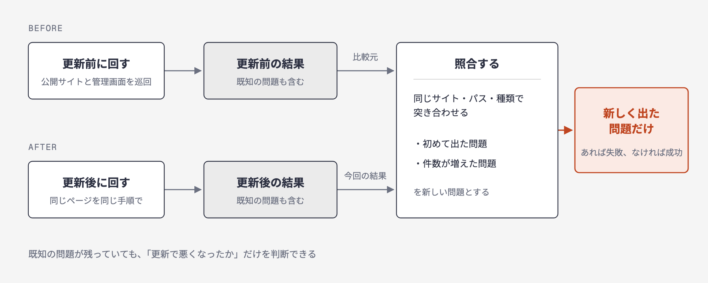

# 依存の大きな更新を、更新前との比較で確かめる。テストが通っても壊れた箇所をスモーク E2E で見つけた

> 区分: 会社公式（PRONI）

PRONI（プロニ）株式会社のプロダクト開発部で、開発プロセスづくりに取り組んでいる小峯将威（[@mine\_take](https://x.com/mine_take)）です。

先日、私たちのプロダクトで、フロントエンドのビルドツールを大きく更新しました。管理画面と公開サイト4つの Vite を 5 から 8 へ、公開サイトと共通コンポーネントの Vitest を 3 から 4 へ上げる更新です。

型チェックも lint も単体テストも、本番ビルドも通りました。それでも、管理画面にはブラウザで動かして初めて分かる不具合が残っていました。見つけたのは、更新前の結果と比べて「新しく出た問題だけ」を拾うスモーク E2E です。

この記事では、その仕組みを作った経緯と、使いながら判定を直していったこと、別の更新でもう一度使ったことを書きます。

## 既知の問題があると、E2E はいつも赤い

依存の更新で一番知りたいのは「更新で何かが壊れたか」です。ところが、私たちの公開サイトには、更新前から残っている問題がありました。一部のページで出るハイドレーションの警告と、一部のサイトで起きる横はみ出しです。

どちらも把握している問題で、今回の更新とは関係ありません。ただ、ブラウザで巡回して問題を数える E2E を作ると、これらが毎回失敗として出ます。いつも赤いテストは、更新で新しく壊れたものがあっても見分けられません。

既知の問題を全部直してから更新する、という順番もあります。でも、それでは更新がいつまでも始められません。そこで、問いを変えました。「問題が無いか」ではなく、**「更新前より悪くなったか」** を確かめることにしたのです。

## 更新前の結果を、比較元にする

作ったスモーク E2E は、公開サイト4つと管理画面を実際のブラウザで巡回します。ページを開き、コンソールのエラーやハイドレーションの警告、横はみ出しなどを記録します。管理画面では一覧と編集画面を開き、値を変えずにフォームを送信します。送信の応答を確かめ、エラー画面が出ずにトーストが表示されるかまで見ます。

記録するのは、サイトとページのパスごとに、どの種類の問題が何件出たかです。たとえば「記事ページで、ハイドレーションの警告が 1 件」のような形です。照合では、サイトとパス、巡回の項目（一覧・編集・送信など）が同じ結果どうしを比べます（画面幅は後で条件に足しました）。その中で、問題の種類ごとに件数を見ます。

結果はファイルに残します。更新の前に一度回して、その結果を比較元にします。更新の後にもう一度回し、比較元と照合して、**更新前には無かった問題と、同じ種類で件数が増えた問題だけ**を一覧にします。新しい問題があれば失敗、無ければ成功で終わります。

依存の更新では、型チェック、lint、テスト、本番ビルド、Dockerfile のビルド用ステージ、そしてこのスモークを、ひとつのスクリプトで順に回すようにしました。

このスモークは、巡回するページと判定の条件を人が決め、スクリプト化と修正を AI エージェント（Claude Code）と分担して作りました。

## テストが通っても、送信すると壊れた

更新したブランチでスモークを回し、比較元と照合したところ、管理画面で新しい問題が見つかりました。フォームを送信すると、トーストが出るはずのところで `Application Error` になっていたのです。

原因は、アイコンの読み込み方でした。CommonJS 形式で配布されているパッケージのアイコンを、default import で読み込んでいました。Vite 8 では、この読み込み方をしたときの解決のしかたが変わりました。その結果、受け取った値はコンポーネントそのものではなく、それを中に包んだオブジェクトになっていました。

この不具合は、型チェックでも lint でも見つかりません。単体テストも通ります。画面でトーストを表示しようとした瞬間に初めて壊れます。

修正は、名前付きの import に書き換えるだけでした。あわせて、そのパッケージのサブパスからの import を lint で禁止し、同じ書き方が入らないようにしました。修正後に回し直すと、巡回した 25 項目のどれにも、更新前と比べて新しく出た問題はありませんでした。

今回壊れたのは、送信という、普段の確認では毎回は押さない操作でした。スモークに「送信してトーストまで確かめる」を入れていたのは、結果として効きました。

## 判定は、使いながら直した

比較の仕組みは、最初から正しく動いていたわけではありません。レビューと実際の運用で、何度か判定を直しました。

一つ目は、比べる範囲です。最初は、比較元に同じページが見つからないとき、問題の種類だけで照合していました。そのため、別のページで出ていた既知の問題が、新しく出た問題を隠してしまうことがありました。そこで、**同じパスのページ同士でだけ比べる**ようにしました。

二つ目は、数え方です。同じページで同じ種類の問題が出ていても、件数が増えていれば新しく壊れた可能性があります。同じ種類の問題は、**件数が増えたときだけ**新しい問題として数えることにしました。

三つ目は、回せなかったときの扱いです。実際に、ローカル環境が応答しないときに、スモークを飛ばしたまま成功で終わっていたことがありました。引数の書き間違いでも、同じことが起こりえます。これを成功として扱うと、確かめていないのに通ったことになります。一括で回すスクリプトの側で、**回せなかったときも失敗で終える**ようにしました。

判定を直したあとは、比較が本当に効いているかも確かめました。比較元のパスをわざとずらして回すと、既知の問題が新しい問題として報告され、失敗で終わりました。

比較の仕組みは、**比べられていないときに静かに成功する**のが一番怖いところです。わざと壊して、失敗することを見ておく。後で幅の条件を足したときも、同じ確かめ方をしました。

## 別の更新でも、もう一度使った

このスモークは、ビルドツールの更新のためだけの道具にはしませんでした。依存の更新とは別の PR に分け、手順書と一緒に残しています。更新のほうを取り消すことになっても、道具は残しておけるようにするためです。分けたのは、レビューでの提案がきっかけでした。

その後、サーバー側の PHP のベースイメージを更新したときに、もう一度使いました。今度は本番のリリース前に公開サイトの結果を取り、リリース後にそれと比べて、既知の問題と新しく出た問題を切り分けました。

このとき、ローカル向けの URL を書き換えた一時的なコピーで回していたので、その手順をスモーク本体に取り込みました。いまは、ローカルだけでなく開発環境と本番の公開サイトも、引数ひとつで巡回できます。開発環境と本番では公開ページを読むだけにし、管理画面は回しません。

あわせて、PC と SP の2つの画面幅で回せるようにしました。幅ごとに全ページを回し直し、結果も幅ごとに分けて記録します。すると、開発環境で出ていた横はみ出しは、PC の 1440px と SP の 375px では起きませんでした。起きていたのは、ブラウザ既定と同じ 1280px のときだけでした。

幅は照合の条件にも足しました。この条件を外した版で回すと、新しい問題が既知の問題に隠れて「なし」になりました。条件が効いていることを、こうして確かめました。

## うまくいっていないこと

使ってみて、まだ手が届いていないこともあります。

ローカルでは、開発サーバーが依存を最適化し直すタイミングで接続が切れることがあり、取り直しの処理を入れました。それでも、ときどき揺れます。

比較元は、取り直しが必要です。依存を上げたとき、既知の問題を直したとき、巡回するページが変わったときです。取り直しを忘れると、既知の問題が新しい問題として出たり、逆に新しい問題が隠れたりします。

また、件数で比べているので、同じ種類の問題が別の問題に入れ替わっても、件数が同じなら見分けられません。

そして、このスモークはまだ CI には入っていません。いまは依存を更新する人が、手元で回しています。定期的に回す手順は手順書に書きましたが、運用として回せている状態ではありません。

## 次に試すこと

次は、このスモークを決まったタイミングで自動的に回すことを試します。依存の更新に限らず、リリースの前後で回せば、気づかないうちに入った回帰を早く拾えるかもしれません。

巡回するページの種類も増やしたいと考えています。今はページの種類ごとに代表を選んで回していますが、同じ種類のページを複数回ったり、サイトマップを確かめたりする案もあります。PR が大きくなりすぎないよう、これは別に分けて進めます。

## おわりに

依存の大きな更新は、テストが通っても安心できません。実行して初めて壊れる箇所があるからです。かといって、既知の問題をすべて直してから更新するのでは、いつまでも始められません。

更新前の結果を比較元にして、新しく出た問題だけを見ます。比較が効いているかは、わざと壊して確かめます。この二つで、既知の問題を抱えたままでも、巡回した範囲で更新前に無かった問題と、件数が増えた問題を拾えるようになりました。

## 参考

- [Vite 移行ガイド（Consistent CommonJS Interop）](https://vite.dev/guide/migration)

---

## 【PR】エンジニアの積極採用を実施中です

最後までお読みいただき、ありがとうございました！

PRONIの開発組織では、事業成長を技術で牽引していくエンジニアメンバーを積極採用中です。今回の記事や、PRONIの開発環境に少しでもご興味を持っていただけた方は、ぜひ以下のリンクからお気軽にご連絡ください。まずはカジュアルにお話ししましょう！

<https://hrmos.co/pages/proni/jobs?category=1962090450939592707>
