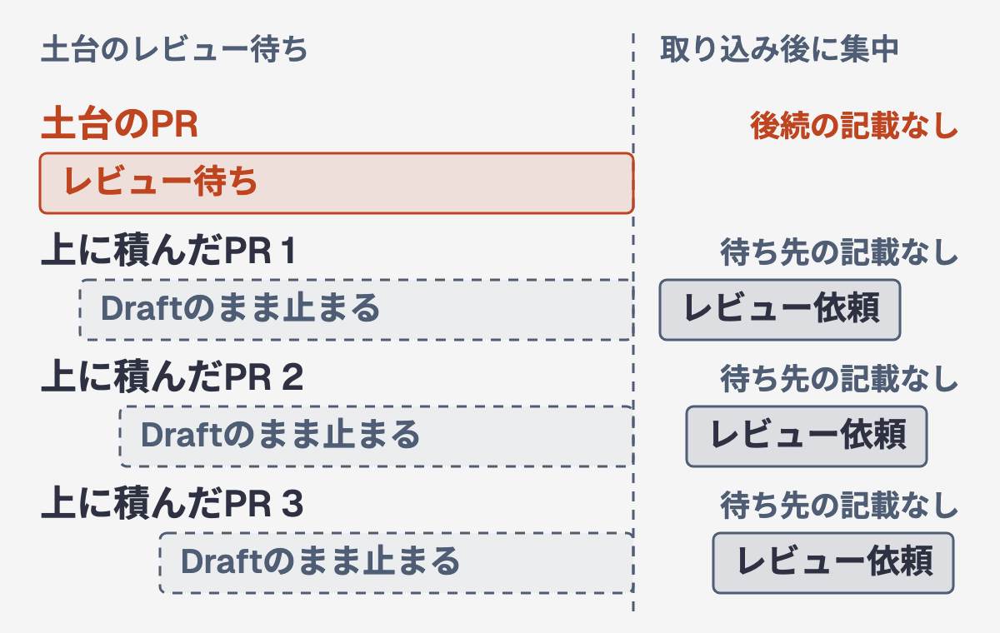

# 小さいPRでもレビュー待ちは溜まる。止めていたのは「後続をブロックする」が書かれていないことだった

> 区分: 会社公式（PRONI）

PRONI株式会社のプロダクト開発部で、開発プロセスづくりに取り組んでいる小峯将威（[@mine\_take](https://x.com/mine_take)）です。

AIエージェントと開発するようになって、PR（Pull Request）を出す頻度が上がりました。一つひとつのPRは小さく、レビューもすぐ終わります。そう考えていたので、レビューの順番を気にしたことはありませんでした。

ところが、あるプロジェクトでレビュー待ちが溜まり、後続の作業が止まりました。振り返ってみると、原因はレビューの遅さではありませんでした。

この記事で伝えたいことは、次のとおりです。

**PRが小さくても、レビュー待ちは溜まります。土台のPRが止まると、その上に積んだPRも止まります。それなのに「このPRが後続をブロックするか」は、どこにも書かれていませんでした。**

何が起きたのか、記録を見直して分かったこと、次にどう変えるかを書きます。

## 1本ずつすぐ見てもらう前提だった

AIエージェントに実装を任せるとき、私たちは大きな仕事を小さなタスクに分けます。タスクごとにPRを出し、レビューを受けて取り込みます。PRが小さければ、レビューする側の負担も小さくて済みます。

このやり方では、出したPRを1本ずつすぐ見てもらうことが前提になっていました。すぐ見てもらえるなら、どのPRから見てもらうかを決める必要はありません。PRの説明にも、そのPRを待っている作業があるかどうかは書いていませんでした。

## 小さいPRでも、待ちは溜まった

複数の機能を並行して開発したプロジェクトで、この前提が崩れました。

PRの中には、そのPRだけ確認すれば済むものがあります。一方で、そのPRが止まると、上に積んだ後続の作業まで止まるものもあります。私たちのプロジェクトでは、土台になるPRのレビューを待つ間、その上に積んだPRが Draft（下書き）のまま止まっていました。

一つひとつは小さいのに、レビューのタイミングが遅れると待ちが溜まる。当時はそう感じていました。待ちが溜まってから、初めてレビューにも優先順位が必要だと気づきました。

## 遅れていたのは、レビューではなく依頼だった

当時の私は、レビューのタイミングが遅れたから溜まったのだと受け止めていました。あとからPRと作業の記録を見直すと、少し違う姿が見えてきました。

レビューを依頼してから承認されるまでは、短く済んでいました。時間がかかっていたのは、その手前です。土台のPRを待つ間、上に積んだPRは Draft のまま長く止まり、レビューの依頼を出せずにいました。土台が取り込まれたあと、止まっていたPRの依頼が短い期間に集中しました。

つまり、レビューする人が遅かったのではありません。**依頼が後ろに寄り、まとめて届いたことで、待ちが溜まって見えた**のです。

## 「後続をブロックするか」は、どこにも書かれていなかった

では、なぜ土台のPRが止まっていることに、早く気づけなかったのでしょうか。記録を見直すと、その情報がどこにも書かれていませんでした。

- 土台のPRの説明には、「このPRが後続のPRを止めている」という記載がありませんでした
- 上に積んだPRの説明にも、どのPRを待っているかは書かれていませんでした
- PRのテンプレートにも、AIエージェントへ作業を頼むときの依頼の項目にも、後続や依存を書く欄がありませんでした

当時も、レビューしてほしい順番の一覧は作っていました。ただ、それはマージする順番と期限で並べたものでした。後続をブロックするかどうかで並べたものではありませんでした。

1本ずつすぐ見てもらう前提なら、この欄は要りません。前提が崩れたとたんに、止まっているPRと、それを待っているPRの関係が見えなくなっていました。

## 小さくすれば早く見てもらえる。それだけでは待ちは防げない

PRを小さくすると、レビューは早くなります。Google のコードレビューを調べた研究でも、小さい変更は、非常に大きな変更より最初の反応が早いという結果が出ています。小さい変更では、最初のフィードバックまでの時間の中央値は1時間未満でした。非常に大きな変更では、約5時間でした（Sadowski ほか, 2018）。

ただ、この研究自体も、レビューが速い理由を変更の小ささだけには求めていません。私たちの経験でも、一つひとつを小さくしただけでは、待ちは防げませんでした。待ちを生んだのは、PRどうしのつながりが見えないことだったと考えています。

AIで開発を速くするときの考え方として、DORAの2025年のレポートには、次のような趣旨の一節があります。コードレビューがボトルネックになっているなら、AIでコードを増やしてもボトルネックが悪化するだけで、AIはレビューの流れそのものの改善に使うべきだ。その前提として、リードタイムや、付加価値を生む時間と待ち時間の比を測るよう勧めています（DORA, 2025）。AIでPRを出す速さが上がるほど、待ちがどこで生まれているかを見る必要があると感じています。

## 次は、こう決める

振り返りから、次の決まりを案として作りました。まだ試していないので、効果は分かりません。次の開発で試していきます。

**1. PRの説明に「後続をブロックするか」を書く**

そのPRを待っている作業があるかどうかは、PRを出す人にしか分かりません。PRのテンプレートに欄を作り、出す人が書くようにします。

**2. レビューの順番は、後続をブロックするかで決める**

待ちが出たら、後続を止めているPRから見てもらいます。どこまで深く見るかは、変更のリスクで決めます。順番と深さを、別の物差しで決めるということです。

**3. 1本ずつすぐ、が崩れた合図を決めておく**

待ちが出てから優先順位を考えるのでは、遅れます。依頼中のPRが何本を超えたら、止まっているPRが何日を超えたら、という合図を先に決めておきます。止めているPRが決めた日数を超えたら、分けるか、別の人にもレビューを頼みます。

## おわりに

PRを小さくすることは、今でも大切だと考えています。ただ、小さくしただけで待ちがなくなるわけではありませんでした。

1本ずつすぐ見てもらえるうちは、PRどうしのつながりは問題になりません。前提が崩れたときに、どのPRが何を止めているかが見えるようにしておきたいと考えています。そのために、PRを出すときに一行だけ書き足します。次の開発では、そこから始めます。

### 参考文献

- Caitlin Sadowski, Emma Söderberg, Luke Church, Michal Sipko, Alberto Bacchelli. "Modern Code Review: A Case Study at Google." ICSE-SEIP 2018. <https://sback.it/publications/icse2018seip.pdf>
- DORA. "2025 State of AI-assisted Software Development." Google, 2025. <https://services.google.com/fh/files/misc/2025_state_of_ai_assisted_software_development.pdf>

---

## 【PR】エンジニアの積極採用を実施中です

最後までお読みいただき、ありがとうございました！

PRONIの開発組織では、事業成長を技術で牽引していくエンジニアメンバーを積極採用中です。今回の記事や、PRONIの開発環境に少しでもご興味を持っていただけた方は、ぜひ以下のリンクからお気軽にご連絡ください。まずはカジュアルにお話ししましょう！

<https://hrmos.co/pages/proni/jobs?category=1962090450939592707>
