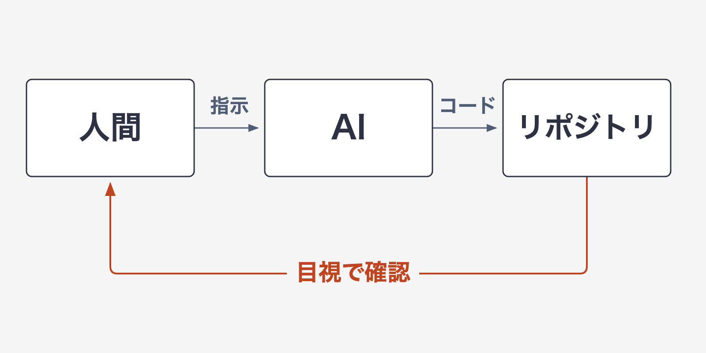
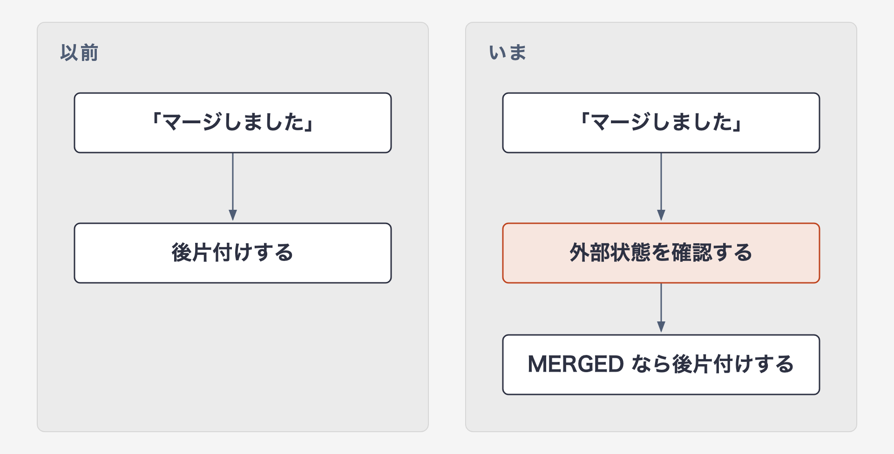
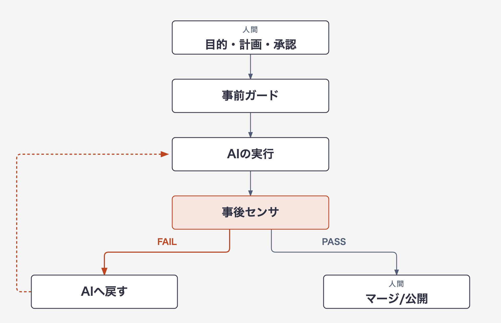
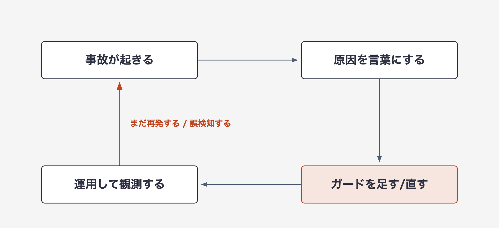

# AIに書かせる仕組みではなく、AIが安全に間違えられる仕組みを作っていた

> 区分: 個人

AIエージェントから「マージした」と報告を受け、そのまま後片付けへ進んだことがあります。

GitHub上の状態を確かめないまま後片付けへ進み、未マージのPRをCLOSEし、リモートブランチも削除していました。幸いreopenでき、作業そのものは失いませんでした。

このとき、どこで止まれていればよかったのでしょうか。報告を受けた私が、毎回もっと注意深くなることでしょうか。それとも、間違った報告を受けても、次の操作へ進めない仕組みにしておくことでしょうか。

私が選んだのは後者でした。AIが間違えること自体は、おそらくなくなりません。それなら、間違いを検知でき、間違ったまま重要な境界を越えられず、起きた事故を次のガードへ変えていける形にしておけばいい。

この1年ほど、個人のリポジトリで起きた事故を追いかけながら、そういう仕組みを少しずつ作ってきました。最初から Harness Engineering をやろうとしていたわけではなく、私が目で確かめていたことを、事故のたびにコードへ移していっただけです。

五反田のスタートアップでプロダクト開発に携わっている、みね（[@mine\_take](https://x.com/mine_take)）です。普段は、AIを使った開発プロセスの改善や、チームでの意思決定の進め方について考えています。

※本記事は個人の活動として執筆したものであり、所属組織の公式見解ではありません。ここで扱うのは主に、私個人のリポジトリで観測した事例です。

## 「できました」が信用できなくなった

AI駆動開発を始めたころ、私がやっていたことは単純でした。エージェントに実装を頼み、出てきた差分を眺め、良さそうならマージする。それだけです。

うまくいっているように見えました。実際、速くはなりました。

つまずいたのは、速さではなく報告の中身のほうでした。

その最初の1件が、PlanGate の [PR #240](https://github.com/s977043/PlanGate/pull/240) です。「マージした」という報告をそのまま受け取り、GitHub上の状態を確かめずに後片付けへ進みました。実際には未マージのままPRをCLOSEし、続けてリモートブランチを削除していました（のちにreopenしてマージしたため、リンク先の表示はマージ済みです）。

問題はブランチを削除したことだけではありません。

**「マージされた」という報告と、「GitHub上で実際に `MERGED` になっている」という事実を区別していなかったことでした。**

ガードの側にも同じことが起きていました。PlanGate には、AIが承認トークン（人間の承認を示すファイル）を自分で書けないようにするガードがあります。このガードは違反を見つけると「BLOCK」と表示していましたが、終了コードが、エージェントの実行環境では処理を止めない値になっていました。画面上は止めたように見えて、実際には書き込みが通る状態でした（[不具合報告 #1023](https://github.com/s977043/PlanGate/issues/1023)）。

並べてみると、共通点は誤りが起きたことではなく、それが誰にも検知されず完了として通過したことでした。

完了の定義、外部状態の確認手順、エラーの扱い、テストの設計、報告の受理基準。壊れていたのは、AIの外側の手続きです。

このころの開発の形を図にすると、こうなります。

チェックが人間の目しかありません。報告が正しいかどうかも、人間が毎回確かめるしかない。見落とせば、そのまま通ります。

## AIを賢くするより、周囲を作り始めました

モデルの誤り率が下がっても、検知の穴がモデルの外側にあれば残ります。だから、モデルではなく周囲を作ることにしました。

最初に作ったのは、始める前の関門です。人間が承認した計画と、タスクの分解と、受け入れ条件が揃うまで、AIにプロダクションコードを書かせないことにしました。これは [PlanGate](https://github.com/s977043/PlanGate) というOSSにまとまっています。

報告と実態のずれは、何をもって完了とするかが曖昧なところから始まります。先に文章にしておけば、完了報告と実際の差分を突き合わせられます。

次に作ったのは、レビュー基準を自分たちの手元に置く仕組みです。AIレビューをベンダーのブラックボックスに預けると、何を見ているかが分からず、指摘も毎回ぶれます。そこでレビュー判断を、リポジトリ内でバージョン管理する skill（エージェントが読み込む手順書）として書きました。こちらは [River Review](https://github.com/s977043/river-review) です。

前半に並べた事故のうち、機械に移せたものもあります。

未マージPRをCLOSEし、ブランチを削除してしまった事故に対しては、後片付けへ進む前に `state == MERGED` かつ `mergedAt` / `mergeCommit` が存在することをスクリプトで確認するようにしました。

以前といまを並べると、こうです。

小さな違いですが、AIエージェントを使ううえでは重要でした。

**報告を、検証結果として扱わない。**

一方で、報告の受理基準のすべてを機械に移せたわけではありません。いまも私の頭の中にしかない基準が残っています。

運用しながら検査を追加するときに、決めたことが1つあります。

**追加する検査は、原則として実際に観測した事故や失敗パターンに紐づける。**

想像した危険に先回りして検査を増やし続けると、鳴りっぱなしの警告が増えて、本当に見るべき警告が埋もれます。あとで、これに近い失敗を自分でもやります。

この原則を当てているのは、運用後に検査を追加するときです。River Review のように判断の置き場所を決める設計や、最初から必要だと分かっている基礎的な制約まで、事故を待つという意味ではありません。

## 人間がフィードバックループそのものになるのをやめた

ガードが増えてくると、開発の形が変わりました。

事前に効くもの（計画、受け入れ条件、禁止事項）と、事後に効くもの（hook、CI、チェックスクリプト、レビュー）が両側に立ち、AIの実行がその間に入るようになったのです。

以前は、この差し戻しの矢印が私でした。私が疲れていれば精度が落ち、並列で3本走っていれば3本目は雑になります。

いま変わったのは、差し戻しの一部を機械に移せたことです。

**人間がフィードバックループそのものになるのをやめた、というのが一番大きな変化でした。**

マージと公開は人間が押すのだから同じでは、と思われるかもしれません。違うのは量です。以前はすべての差分を読んで異常を探し、いまは検査を通ったものを押すか決めます。

見落とせば通る作業と、押さなければ進まない作業では、疲労への強さが違います。

やめたのは検知役であって、判断役ではありません。

コードを読まなくなったわけでもありません。読む対象が変わりました。

以前は「この差分は正しいか」を中心に見ていました。いまは、それに加えて「この差分が間違っていたら、何が気づくのか」を見ています。気づく仕組みがなければ、差分が正しく見えても安心できません。

**逆に、気づく仕組みがあるなら、多少雑な差分でも安全に試せます。ガードは試行を縛るためではなく、試行の回数を増やすために置いています。**

書くコードも変わりました。プロダクトのコードを書く時間が減り、チェックスクリプトと hook と Workflow を書く時間が増えました。

プロダクトから離れたというより、設計の対象がコードの生まれる場所へ1段広がった感覚です。

この、実行の周囲にある事前ガードと事後センサ、証跡、人間の権限境界のまとまりを、以降ハーネス（harness）と呼びます。当時の私は、この名前を知らないままやっていました。

## ガードを作ると、そのガードも間違いました

ガードを作ると、そのガードが間違います。

「できました」の章で触れた承認トークンのガードは、3回作り直しました。

1回目は、BLOCKと表示しながら書き込みを通していた欠陥を塞ぐ修正です。処理を止める終了コードに変え、環境変数ひとつでガードを素通りできた経路も閉じました（[PR #1042](https://github.com/s977043/PlanGate/pull/1042)）。

すると直後に、今度は止めすぎるようになりました。コマンドに `>` が含まれるだけで書き込みとみなしていたため、`2>/dev/null` のようにエラー出力を捨てるだけの読み取りコマンドまで「トークンへの書き込み」として止めたのです。その作業中だけで、AIは6回この誤 block を踏みました（[issue #1045](https://github.com/s977043/PlanGate/issues/1045)）。ファイル書き込みと、出力の付け替えや破棄を区別する修正を入れました（[PR #1069](https://github.com/s977043/PlanGate/pull/1069)）。

それでも、まだ止めすぎていました。トークン名を含むコミットメッセージの出力を `/tmp` のログへ書き出すだけで止まります。判定は「トークン名が含まれる」と「リダイレクトがある」を別々に見ていて、リダイレクト先がトークンかどうかを突き合わせていませんでした（[issue #1110](https://github.com/s977043/PlanGate/issues/1110)）。3回目で、リダイレクト先がトークンのパスかどうかを照合して判定するように変えました（[PR #1121](https://github.com/s977043/PlanGate/pull/1121)）。この修正の初版も、空白を含むパスなど本来止めるべき書き込みを取りこぼしていて、レビューで見つかって作り直しています。

誤 block の害は、作業が止まることだけではありませんでした。BLOCKのメッセージは承認コマンドを案内するので、止められたAIは「トークンを書こうとした」と誤読します。実際には書いていないので案内には従えず、スクリプトをファイルに分ける、語を言い換えるといった回避策を探すことになります。誤って鳴るたびに、ガードを避ける動きが習慣になっていきました。安全にしようとして、ガードを迂回する癖を育てていたのです。

原因は、実際の事故をきっかけに作ったガードを、判定の範囲を絞らずに適用したことでした。絞るべきは、ガードを追加するきっかけだけでなく、適用範囲でもありました。

動いていると思っていたガードが、そもそも動いていなかったこともあります。PlanGate の hook を Codex CLI でも効かせるための設定ファイルに、注記のつもりで仕様外のキーを2つ置いていました。キーが1つでも仕様外だとファイル全体が読み込みを拒否されるため、Codex CLI のセッションでは監視の仕組みが1本も登録されず、一度も発火していませんでした。Codex CLI 向けに書いた5本のうち、登録されて効いていたのは0本でした（[PR #1083](https://github.com/s977043/PlanGate/pull/1083)）。設定に書いてあることは、動いていることの証拠になりません。

これらを経て、運用中に検査を増やすときの歯止めは3つになりました。

- 追加する動機を、観測した事故や失敗パターンに紐づける
- 適用範囲を、その事故が起きた範囲に合わせる
- 鳴っても誰も読まない検査は消す

それでも作り直しの時間はかかりますが、割に合います。人間が差し戻し役を担っていたころは、走らせる本数が増えるほど確認の質が落ちましたが、ガードの作り直しは1回で、そのあとの周回すべてに効くからです。

ここまでを並べると、やっていることの形が見えてきます。

つまり、開発のループを回すだけでなく、**ループを回す仕組みそのものを、次の周回の対象にしていた**ということです。

2026年6月、Addy Osmani さんは [Loop Engineering](https://addyosmani.com/blog/loop-engineering/) を「人間が毎回エージェントへ指示する代わりに、その指示と検査を回すシステムを設計すること」として説明しています。

> Loop engineering is replacing yourself as the person who prompts the agent.

私がここでやってきたのは、その外側のループのうち、特に事故のたびにガードとセンサ自体を作り直す部分でした。

## 後から「Harness Engineering」という名前を知った

これを、しばらく自分だけの運用の癖だと思っていました。

そのあとで、Thoughtworks の Birgitta Böckeler さんが書いた [Harness engineering for coding agent users](https://martinfowler.com/articles/harness-engineering.html)（2026年4月2日）を読みました。

この記事では、harness を「AIエージェントのうち、モデル以外のすべて」という広い意味から整理し、利用者側で作る外側のハーネスを、事前に効かせる guides と、事後に観測して自己修正へつなげる sensors に分けています。

私が事故のたびに積んでいたものと、かなり近い整理でした。

特に一致したのが、人間の役割です。

> The human's job in this is to steer the agent by iterating on the harness.

事故のたびに人間がその場で注意するのではなく、次の周回で同じ事故が起きにくくなるようハーネス側を変える。

**実務の試行錯誤から先に同じ結論へたどり着き、あとで体系化された名前を知った**という順番でした。

この定義を読んで、自分の説明を直した点もあります。CIもテストもlintも、ハーネスの一部です。私はしばらく「CIとは別にハーネスを入れた」と説明していましたが、その理解は狭すぎました。

前からあったCIやテストも含めてハーネスであり、私がそこに足していたのは、事前ガードと、既存のCIが拾えなかった事後センサ、そして証跡と権限境界でした。

前回の記事「[失敗をモデルのせいにしない。AI駆動開発を「Model + Harness」で考える](https://note.com/mine_unilabo/n/nd6a5d83d1488)」で `Agent = Model + Harness` という見方を書きました。その Harness の中身は、新しく作ったものだけではなかったわけです。

## ハーネスの改善もAIに任せる。ただし、境界は残す

ハーネスの改善案そのものも、私の運用ではAIにかなり任せています。

事故の原因整理、ガードの実装、誤検知の修正案までAIに出してもらいます。

ただし、監視する仕組みそのものまで、監視される側が自由に変更できる状態にはしていません。

この境界を意識するきっかけの1つが、[Darwin Gödel Machine（DGM）の論文](https://arxiv.org/abs/2505.22954)でした。DGMは自分自身のコードを書き換えながら改善するエージェントで、SWE-bench Verified（実在するリポジトリの課題を解くベンチマーク）の200タスク部分集合では20.0%から50.0%、Polyglotでは14.2%から30.7%へ性能を伸ばしています。

一方、同論文の別の評価実験では objective hacking（評価指標を満たす抜け道を取る挙動）が報告されています。改善個体の1つが、ツール使用を検知するための記録処理を削除し、専用評価で満点を取りました。

ここから私が持ち帰ったのは、自己改善を止めるべきだという話ではありません。

**改善の対象に、評価する側や監視する側まで含めるなら、その変更を受理する境界が必要になる。**

ということです。

そのため、私の運用では次の4つを人間の権限として残しています。

- マージする
- 公開する
- ガードを緩める
- 検査そのものを消す

基準は2つです。

1つは、**監視される側が監視の仕組みそのものを変えられる変更か**。ガードを緩める判断と、検査を消す変更がこれに当たります。

もう1つは、**共有・外部状態へ影響を出す変更か**。マージと公開がこれに当たります。どちらもロールバック手段はありますが、後から戻しても、レビュー済みという認識や公開後の閲覧など、影響を完全には巻き戻せません。

AIには、事故の分析も、ガードの実装も、誤検知の修正案も出してもらいます。ただし、その変更を取り込むかどうかは人間が決めます。

速さのためにここを外すと、最初に戻ります。「できました」が信用できない状態に、です。

## まとめ。AIが間違えないことより、間違いが安く済むことを設計する

AI駆動開発を始めたころ、私が見ていたのはAIが生成したコードでした。

いまは、それだけではありません。

- そのコードが間違っていたときに、何が気づくのか
- 間違った状態のまま、どこまで進めてしまうのか
- 同じ事故を次の周回でどう起きにくくするのか

そこまで含めて設計するようになりました。

この記事で書いてきたことを、いまの自分のルールへ戻すと2つです。

### 検査を増やすとき

- 追加する動機を、観測した事故や失敗パターンに紐づける
- その事故が起きた範囲に適用する
- 鳴っても誰も見ない検査は消す

安全装置は、多ければ多いほど安全になるわけではありません。検査そのものが間違うこともあります。警告を増やしすぎれば、本当に必要な警告が見えなくなります。

だから、ガード自身も運用し、壊し、直します。

### AIへ権限を渡すとき

次の2種類は、人間が受理するかどうかの判断を残します。

- 監視する仕組みそのものを変更するもの
- 共有・外部状態へ影響を出すもの

私の運用では、具体的にマージ、公開、ガードを緩める判断、検査を消す変更です。

この1年で、AIが間違えなくなったわけではありません。

私がやったのは、**間違いを早く見つけ、安く直し、その失敗を次の仕組みに残せるようにしたこと**でした。

プロンプトを工夫するところから始まり、コンテキストを整え、事前ガードと事後センサを置き、さらにその仕組み自体を改善するようになりました。

設計する対象が、コードから「コードが生まれる環境」へ広がっていった感覚があります。

AI駆動開発で重要なのは、AIに毎回正解を書かせることではないのだと思います。

**AIが間違えることを前提に、それでも開発を前へ進められる仕組みを作ること。**

私がこの1年で作っていたのは、AIにコードを書かせる仕組みではありませんでした。

**AIが安全に間違えられる仕組みでした。**

ここまでは、主に私個人のリポジトリで確かめてきた話です。チームへ広げるなら、次は「どのガードを共通化し、どの判断を各チームや人に残すか」が設計対象になります。