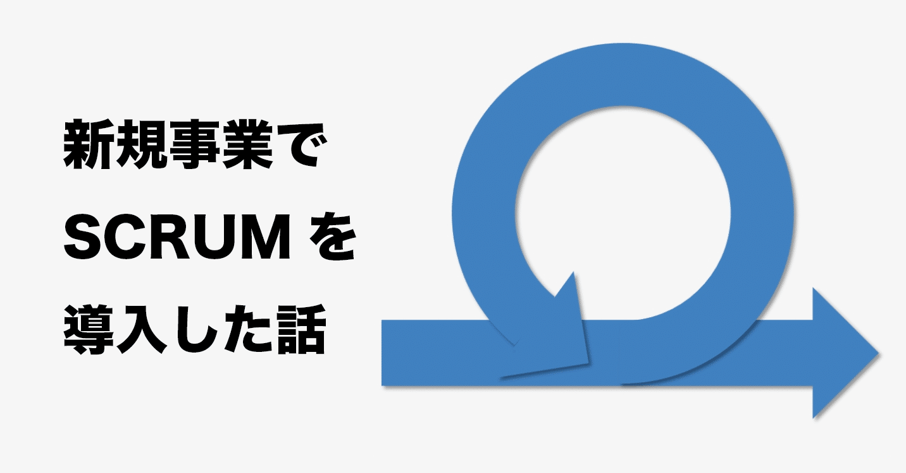
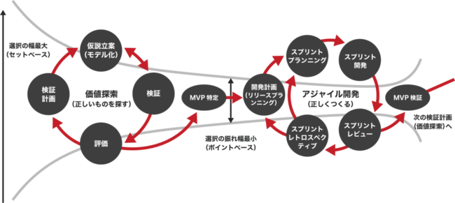

# プロダクト開発にScrumを導入した話

> 出典: https://note.com/mine_unilabo/n/nb068316a12ec  
> 公開状態: publish  
> 更新: Fri, 12 Nov 2021 08:01:46 +0900

株式会社ユニラボで[アイミツCLOUD](https://imitsu-cloud.jp/)という新規事業のプロジェクトでエンジニアのマネージャーをしています、みね＠ユニラボ（[@mine\_take](https://twitter.com/mine_take)）です。

この記事では、スクラムを選んだ理由と、導入によりチームに期待したことを書きます。

## アイミツCLOUDのプロダクト開発にスクラムを導入

2021年9月に入社して、プロジェクト開発にスクラム（Scrum）を導入した話を書こうと思います。

アイミツCLOUDがどのような想いで作られたのかは、次の記事を読んでください。

> [新規事業と飽くなき探究心](https://note.com/noriokuriyama/n/n28d0ed49e56d)

アイミツCLOUDは2021年4月にリリースしたwebサービスです。9月に私が入った時は、プロダクト開発の不確実性とどう戦っていくかという、戦い方の話をしている真っ最中でした。

その中で固めていたのが、「正しいものを正しくつくる」という考え方（「正しいものとは何か？」という自問に対して、仮説検証をしながらつくるべきものを探っていく）でプロダクトの開発を行うために、「仮説検証型アジャイル開発」という手法で進めていくという方針です。

> （仮説検証型アジャイル開発のイメージ図）
> 出典元 : [PR TIMES のプレスリリース](https://prtimes.jp/main/html/rd/p/000000016.000066787.html)

## 仮説検証型アジャイル開発とは

私が参加したこの時期は、初期のリリース後の混沌も落ち着き、立ち上げメンバーとバトンタッチなどもあり、チームとしての大きな変革をする良いタイミングでした。

初期のプロダクト開発では「不確実性が高い」＝「分からないことが多い」ということが多くあり、仮説検証を通じて『分からないことを分かるようにしながら』進めていくという開発手法を用い、組織体制や運営方法、コミュニケーションの取り方の見直しを行いました。

## 「正しくつくる」ために

プロセスを「正しいものを探す」と「正しくつくる」を分けた場合に、「正しくつくる」ために、アジャイル開発のスクラム（Scrum）という手法が最適だと考えていたので、導入を決めました。

※「スクラム開発」という言葉がたまに使われますが、スクラムはアジャイル開発のための1つの手法であり、スクラム開発という言葉は正しくないと常々思っています。

スクラム以外にも、エクストリーム・プログラミング（XP）やユーザー機能駆動開発（FDD）という、アジャイル開発の手法があります。

## スクラムを選んだ理由

開発手法としてスクラム（Scrum）をなぜ最適と考えたのかは、下記の理由からです。

- 開発者が5~7人以下のチームで行うことが多く、チーム規模に合っている
- スクラムは各プロセスがわかりやすく（原理原則もスクラムガイドに示されている）、導入済みの他社事例などの情報が多くあるので開発手法について、共有認識を持ちやすい
- スプリントの期間が決まっているので、仮説に対して、定期的に検証・評価を行うタイミングがある
- 多くのフィードバックを受ける機会があるので、早く問題に気づきやすい
- プロダクトオーナー、スクラムマスター、スクラムチームと役割が決まっている

## チームに期待したいこと

また、直接的にスクラムを導入した目的ではありませんが、導入により下記のことに期待をしました。

- プロダクトの「不確実性」に取り組んでいることを意識できる
- 「正しいものをつくる」ために与えられた結果ではなく、「正しいものとは何か？」をチームとして考えていくことができる
- 仮説検証に基づいて、プロダクトのあるべき姿を定義しながら、プロダクトを作っていくことを意識できる

実際に導入した話として、次の記事でスプリント0に向けた準備と、大変だったスプリント0の話を書きたいと思います。

導入前夜・準備したこと：

<https://note.com/embed/notes/n288c21a89778>

スプリント0をやってみてのふり返り：

<https://note.com/embed/notes/n79e2918aa7f4>

## [PR]ユニラボ に興味がある方へ

ユニラボではプロダクト開発を一緒にやってくれるメンバー（エンジニア、PdMなど）募集しています。
カジュアル面談もやっているので、気軽にお問い合わせください！

<https://note.com/embed/notes/ne17b9a378f32>

<null>

<null>
