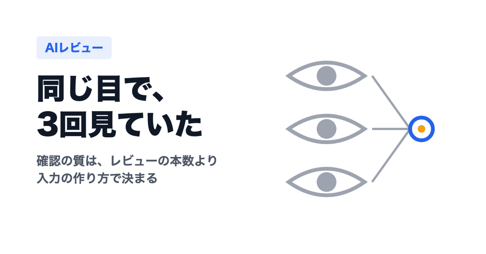
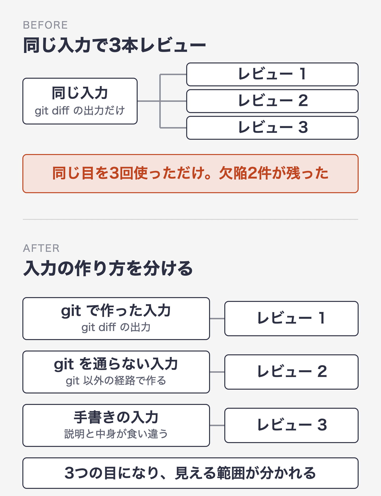

# AIレビューを3回重ねても、見落としは残った。確認の質は何で決まるのか

> 出典: https://note.com/mine_unilabo/n/nf4a30bdbb91d  
> 公開状態: publish  
> 更新: Sun, 22 Nov 2026 23:44:12 +0900

## レビューを増やせば安心できると思っていました

AIのレビューを3本重ねたのに、欠陥が2つ残りました。

小峯将威（[@mine\_take](https://x.com/mine_take)）です。個人でAIを使った開発プロセスの改善を試しながら、チームでの意思決定の進め方を考えています。

※本記事は個人の活動として執筆したものであり、所属組織の公式見解ではありません。

AIにコードを書かせるようになってから、1回のレビューでは不安で、AIのレビューを何本も重ねるようにしていました。3回やれば観点も3つに分かれるので、見落としはないだろうと考えていたのです。

結論を先に書きます。確認の質を決めていたのは、レビューの本数ではありませんでした。観点、つまり何を、どの入力で確かめるかの分け方でした。

AIのレビューを重ねて安心している人に向けて、そう考えるに至った2つの場面と、いま自分に問うようにしている2つの問いを書きます。

## 同じ入力なら、3本のレビューも同じ目になる

個人で開発している River Review（AIによるコードレビューのツール）の作業で、敵対的なレビュー（あえて欠陥を探しにいくレビュー）を3本入れたことがあります。

それでも、欠陥が2つ残りました。

後から調べると、理由ははっきりしていました。3本とも、テスト用の入力を同じやり方（git diff の出力）で作っていたのです。git を通らない形の入力で起きる欠陥は、3本のどれでも試せていませんでした。

観点が違うつもりでも、入力の作り方が同じなら、観点は分かれていません。見える範囲は同じになります。3本のレビューは、3つの目ではなく、同じ目を3回使っていたことになります。

ツールを足しても同じでした。別の作業では、同じ形の不備が3か所ありました。静的解析ツール（CodeQL）が警告を出したのは、そのうち1か所だけでした。

正直、びっくりしました。振り返ると、問題はレビューやツールの数だけではなく、それを受け取る私の側にもありました。

## 確認を増やすと、確認を止める理由になる

この欠陥を通してしまった私の側の振る舞いには、名前があります。自動化バイアスです。

ヒューマンファクター研究の Parasuraman と Manzey は、自動化された判断支援を使う人の研究を整理しました。2010年のレビュー論文の要旨では、次のように述べています。

- 判断支援が不完全なとき、人は見落としも誤った採用も起こす
- これは初心者にも熟練者にも起き、訓練や指示では防げない
- 複数の作業で注意が分かれていると、支援を確かめずに信じやすくなる

レビューを3本入れたことで、私は「3本も通したのだから大丈夫」と考えていました。確認を増やしたことが、かえって確認を止める理由になっていたのです。

## 見落としが出ても、ルールは足さなかった

もう1つの場面です。同じ見落としを2回繰り返したことがありました。

普通なら、チェックリストに項目を1つ足すところです。でも調べると、原因はルールの穴ではありませんでした。正しい確認手順は既にあり、私がそれを実行していなかっただけでした。

既に正しいルールがあるのに項目を足すと、チェックリストは長くなり、形だけのものになっていくと考えました。そこで、ルールは足さず、改善案を3つに絞りました。

ルールを増やすのは、運用を考えるとよくありません。もともとそう考えていたので、足す以外の選択肢を選べたのはよかったと思っています。

## ルールを足すほど、変更を見る注意が減る

ここで、もう1つの概念を借ります。認知負荷です。

教育心理学者の Sweller は、1988年に論文を発表しました。問題を解くことに頭の処理能力を使うと、学ぶことに回せる分が減る、という主張です。人が一度に扱える情報には限りがある、という考え方です。

この論文はレビューの研究ではありません。ここからは私の類推です。

確認のルールが増えると、ルールを思い出して当てはめること自体に注意を使います。その分、目の前の変更を見る注意が減ります。ルールを足すほど安心は増えますが、確認の質は上がるとは限りません。

レビューを信じすぎることと、ルールで注意が足りなくなること。この2つは別の現象に見えますが、どちらも確認を「本数」や「項目数」で考えたときに起きていました。

## 本数ではなく、観点の分け方を設計する

2つの場面から、私は確認の仕方をこう変えました。

- **レビューの本数を増やす前に、入力の作り方を分ける。** River Review の作業では、入力を「git で作ったもの」「git を通らないもの」「手書きで作った、説明と中身が食い違うもの」の3種類に分けて、明示的に試すことにしました
- **見落としが出たら、まず既存の手順を守れていたかを見る。** ルールの穴か、実行しなかっただけかを分けてから対策を決めます

これで見落としがどれだけ減ったかは、まだ測っていません。言えるのは、レビューを足しても、ルールを足しても、確認の質は自動的には上がらなかったということです。

今は、レビューを重ねる前に、次の2つを自分に問うようにしています。

- **重ねたレビューは、入力の作り方まで違うか？**
- **見落としはルールの穴か、それとも実行しなかっただけか？**

3回重ねても、見落としは残りました。AIに確認を任せる場面が増えるほど、「何回確認したか」より「どの観点で確認したか」を設計する必要があると考えています。次にレビューを1本足したくなったら、その前に、入力の作り方が分かれているかを見てみてください。

## 参考

- Parasuraman, R., & Manzey, D. H. (2010). Complacency and bias in human use of automation: An attentional integration. Human Factors, 52(3), 381-410.（[PubMed](https://pubmed.ncbi.nlm.nih.gov/21077562/)）
- Sweller, J. (1988). Cognitive load during problem solving: Effects on learning. Cognitive Science, 12(2), 257-285.
